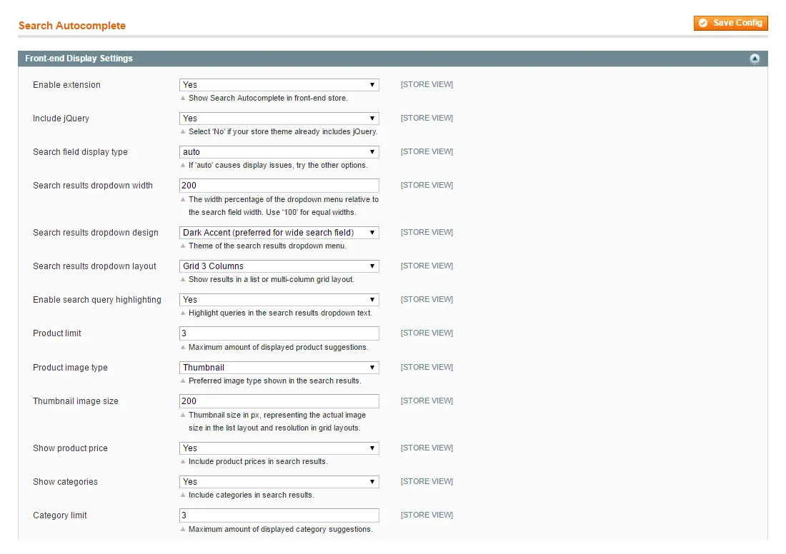

# Search Autocomplete for Magento 1 / OpenMage

**Instant search suggestions for Magento, served from a pre-built cache.**


Shows product suggestions as soon as the customer starts typing in the search box.

Suggestions come from a pre-built cache instead of AJAX requests, so they appear without delay, also in stores with tens of thousands of products.

> [!NOTE]
> Search Autocomplete is free and open source under the MIT License (since 2026). Plugin Company no longer actively develops this extension, but issues and pull requests are welcome.

## Features

- Search suggestions from the first key press
- Two front-end themes
- List layout and two multi-column grid layouts
- Adjustable dropdown width and optional query highlighting
- Include prices, categories and CMS pages in the results
- Sort results by keywords or price
- Choice of product image type and thumbnail size
- Suggestion attributes per store view
- SKU and product name parsing for more matches
- Keeps Magento's full store search
- Tested in stores with tens of thousands of products

## Screenshots

<table>
  <tr>
    <td width="50%" valign="top"><br><sub>3 column grid layout with light theme</sub></td>
    <td width="50%" valign="top"><br><sub>2 column grid layout with dark theme</sub></td>
  </tr>
  <tr>
    <td width="50%" valign="top"><br><sub>2 column grid layout with light theme</sub></td>
    <td width="50%" valign="top"><br><sub>List layout with light theme</sub></td>
  </tr>
  <tr>
    <td width="50%" valign="top"><br><sub>List layout with dark theme</sub></td>
    <td width="50%" valign="top"><br><sub>Front-end display settings (1 of 2)</sub></td>
  </tr>
</table>

More screenshots are on the [product page](https://plugin.company/magento1-extensions/search-autocomplete.html).

## Compatibility

- **Magento:** Community Edition 1.4.x – 1.9.x, Enterprise Edition 1.8.x – 1.14.x
- **Latest version:** 1.14.4 (released 2020-09-09)
- **Composer package:** `plugincompany/magento1-search-autocomplete`
- **Module:** `Plugincompany_Autocomplete`

## Installation

### modman

```bash
cd /path/to/magento
modman init   # once per Magento installation
modman clone https://github.com/PluginCompany/magento1-search-autocomplete.git
```

modman creates symlinks, so enable *Allow Symlinks* under System > Configuration > Advanced > Developer > Template Settings.

### Composer

With [magento-hackathon/magento-composer-installer](https://github.com/Cotya/magento-composer-installer) (it reads the `modman` file of this repository):

```bash
composer config repositories.plugin.company composer https://plugin.company/
composer require plugincompany/magento1-search-autocomplete
```

Your project `composer.json` needs the Magento root directory in its `extra` section (and, with Composer 2.2+, the installer plugin allowed), for example:

```json
{
    "extra": { "magento-root-dir": "./" },
    "config": { "allow-plugins": { "magento-hackathon/magento-composer-installer": true } }
}
```

### Manual installation

Download the ZIP of the latest release from the [tags page](https://github.com/PluginCompany/magento1-search-autocomplete/tags) ([1.14.4](https://github.com/PluginCompany/magento1-search-autocomplete/archive/refs/tags/1.14.4.zip)) and copy the `app/`, `js/`, `skin/`, `shell/` folders into your Magento root:

```bash
unzip magento1-search-autocomplete-1.14.4.zip
cp -R magento1-search-autocomplete-1.14.4/app magento1-search-autocomplete-1.14.4/js magento1-search-autocomplete-1.14.4/skin magento1-search-autocomplete-1.14.4/shell /path/to/magento/
```

Step-by-step instructions are in the [installation guide](docs/02-installing-the-magento-extension.md).

### After installing

Clear the cache (System > Cache Management, or `rm -rf var/cache/*`), then log out of the admin and log in again so the new configuration sections and permissions are loaded.

> [!NOTE]
> Some files of this extension are also shipped by other Plugin Company Magento 1 extensions: `js/plugincompany/jquerynoconflict.js` (also in 8 other extensions). The original ZIP packages simply overwrote each other's copy; with modman or the Composer installer the second extension reports an existing target for these paths.

### Upgrading from a purchased copy

Replace the old files with this release. No license key is needed; your settings and data stay as they are.

## Documentation

- [Documentation in this repository](docs/README.md) (Installation Guide, User Manual, Extension FAQ)
- Online documentation: <https://plugin.company/knowledge-base/docs/magento-search-autocomplete/>
- Product page: <https://plugin.company/magento1-extensions/search-autocomplete.html>

## Changelog

See [CHANGELOG.md](CHANGELOG.md) for the release history.

## Contributing

Found a bug or have an improvement? Please open an [issue](https://github.com/PluginCompany/magento1-search-autocomplete/issues) or send a [pull request](https://github.com/PluginCompany/magento1-search-autocomplete/pulls). Since the extension is no longer actively developed by Plugin Company, fixes from the community are the best way to keep it working on current Magento 1 / OpenMage and PHP versions.

## License

Plugin Company's code in this repository is released under the [MIT License](LICENSE), Copyright (c) 2014-2026 Plugin Company.

Bundled third-party libraries keep their own licenses; see [THIRD-PARTY-NOTICES.md](THIRD-PARTY-NOTICES.md) for the full list.
