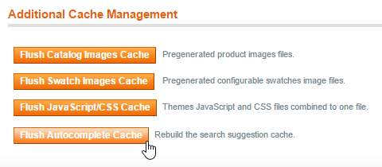

# Flushing the Autocomplete Cache

After successfully installing the Search Autocomplete extension, first make sure to flush the autocomplete cache by navigating to **System > Cache Management** in the top Admin Panel menu.

Click the 'Flush Autocomplete Cache' button at the bottom of the page to rebuild the search suggestion cache.

It's recommended to flush the autocomplete cache every time when significant changes have been made to the product attributes that are used as search autocomplete titles, descriptions and keywords in the [Product Suggestion Settings](./05-configuring-the-search-autocomplete-extension.md#product-suggestion).

You will also need to flush the Search Autocomplete cache after updating the extension's [Front-end Display Settings](./05-configuring-the-search-autocomplete-extension.md#frontend-display) in order to show the changes in your store.



## Flushing the Autocomplete Cache Using the Command Line

It's also possible to flush the autocomplete cache using the following command in your Magento root folder:

```bash
php shell/rebuildSearchAutocompleteCache.php
```

Flushing the cache using the command line can be especially useful for webshops with very large product databases, or for configuring a Cronjob to automatically flush the cache periodically, for example every week or month.

## Periodically Flushing the Autocomplete Cache Using Cron

From Search Autocomplete v1.8.0 and above it's also possible to periodically rebuild the Autocomplete Cache using Cron. You can configure the Cronjob in the [Cronjob Configuration](./05-configuring-the-search-autocomplete-extension.md#cronjob) section of the extension's config screen.

---

[Documentation index](./README.md) · [README](../README.md) · [Online version](https://plugin.company/knowledge-base/docs/magento-search-autocomplete/user-manual/flushing-the-autocomplete-cache/)
