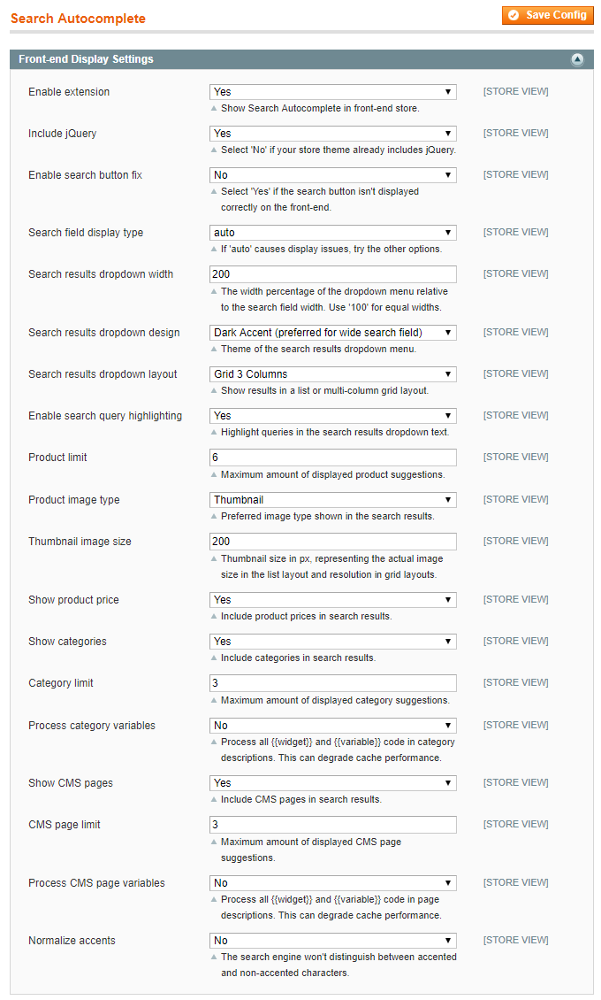
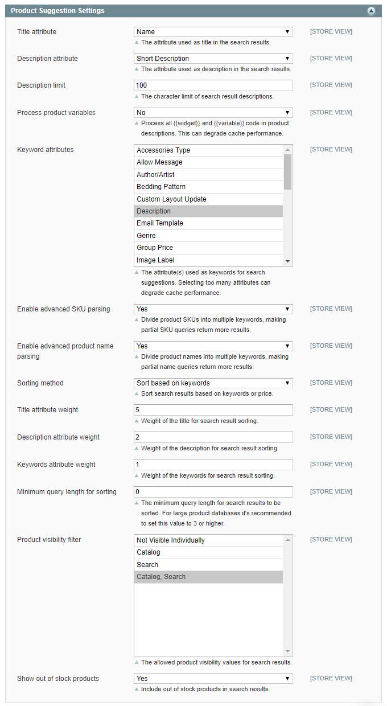
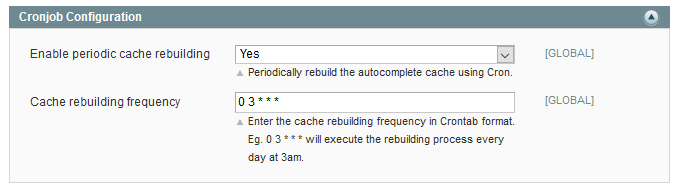

# Configuring the Search Autocomplete Extension

To configure the extension, navigate to **System > Configuration** in the top Admin Panel menu and select **Search Autocomplete** from the left side menu.

Using the extension's config page you can modify the Search Autocomplete front-end display and product suggestion settings as further explained below.

It's possible to configure the extension per store view by changing the 'Current Configuration Scope' at the top left corner of the page.

To save any changes made in the Search Autocomplete settings, click the 'Save Config' button in the top right corner of the configuration page.

**IMPORTANT**: Please remember to [**flush the autocomplete cache**](./04-flushing-the-autocomplete-cache.md) when updating the settings in order to show the changes on the front-end.

## Front-end Display Settings

In the Front-end Display Settings you can:

- Enable the extension to add the Search Autocomplete functionality to your front-end store.
- Choose to use the extension's jQuery library. Select 'No' if your front-end theme already includes jQuery.
- Enable the automatic search button fix, if the search button isn't displayed correctly on the front-end.
- Select the appropriate search field display type, which by default is set to 'auto'. If this option causes display issues in your store theme, please try the other display types.
- Configure the width percentage of the search results dropdown menu relative to the search field width, which by default is set to '200' (%). Enter '100' for equal search field and dropdown widths.
- Select a search results dropdown design, choosing between the 'Light Accent' and 'Dark Accent' theme. 'Light Accent' has blue texts and a white background, changing to light blue when hovering above a search result. Because this design has less padding, it's more suitable for narrow search fields and the list layout. 'Dark Accent' shows grey-blue texts and a light blue gradient background, which changes to dark blue when hovering above a search result. Because it has more padding this theme is more suitable for wider search fields and grid layouts.
- Select a search results dropdown layout, choosing from a single column list layout or 2 to 3 column grid layout. The grid layouts are especially useful for product suggestions focused on images.
- Enable search query highlighting to automatically underline and emphasize entered queries in the search results dropdown text.
- Set the maximum amount of displayed product suggestions per search query, which also defines the number of rows used in the grid layouts. For example, to show two rows in a 3 column grid layout, it's best to enter a product limit of 6.
- Select the preferred product image type for the search results, choosing from thumbnail, small image or base image. If the selected image type is not found for a certain product, the extension will automatically show an alternative image type in the search results.
- Define the product image thumbnail size in pixels, which by default is set to '70' (px). Please note that If the list layout is used, the thumbnail size reflects the actual size of the product image in the dropdown menu, while in the grid layouts the thumbnail size only affects the resolution of the product images.
- Choose to include product prices, categories and CMS pages in the search results. It's possible to exclude certain CMS pages from the search results using the 'Show In Search Autocomplete' option in the Page Information tab of the CMS page view (**CMS > Pages**).
- If enabled, set the maximum amount of category and CMS page suggestions per search query and choose to process any `{{widget}}` and `{{variable}}` code in category and/or CMS page descriptions. Please note that the latter option can slow down the cache performance.
- Enable the 'Normalize accents' option if the search engine shouldn't distinguish between accented and non-accented characters used in search terms.

See the Search Autocomplete [front-end examples](./06-search-autocomplete-frontend-examples.md) for the various dropdown layouts, designs and autocomplete options.

## Product Suggestion Settings

In the Product Suggestion Settings you can:

- Select the attribute used as the product title in search results, which by default is set to 'Name'.
- Select the attribute used as the product description in search results, which by default is set to 'Short Description'.
- Set a character limit for the search result descriptions, which by default is set to '100' (characters).
- Choose to process any `{{widget}}` and `{{variable}}` code in product descriptions, which can slow down the cache performance.
- Select the attribute(s) used as keywords for the product suggestions. It's recommended to select only a few relevant attributes to avoid slowing down the cache performance.
- Enable the advanced SKU and product name parsing options, which divides product SKUs and names into multiple keywords to generate more results for partial SKU / name search queries.
- Choose to sort search results based on keywords or product price.\
  \
  If the 'Sort based on keywords' option is selected, you can configure the weight given to search queries found in the title, description and keywords attributes. The weight given to these attributes defines their priority in search result sorting, where a higher weight means higher priority.\
  \
  If the 'Sort based on price' option is selected, you can choose to sort search products by lowest or highest price.
- Set a minimum query length for search result sorting, which is recommended for large product databases.
- Select the allowed product visibility values for the search results.
- Choose to show out of stock products in the search results.

## Cronjob Configuration

In the Cronjob Configuration section you can:

- Enable periodic autocomplete cache rebuilding using Cron.
- Enter the cache rebuilding frequency in Crontab format, which by default is configured to be executed daily at 3am.

---

[Documentation index](./README.md) · [README](../README.md) · [Online version](https://plugin.company/knowledge-base/docs/magento-search-autocomplete/user-manual/configuring-the-search-autocomplete-extension/)
