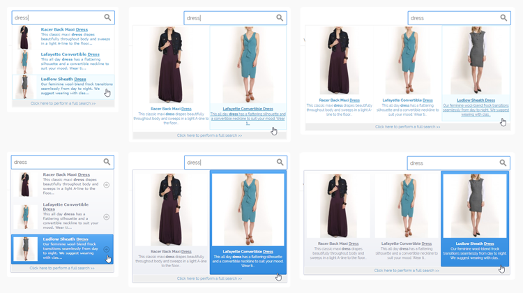
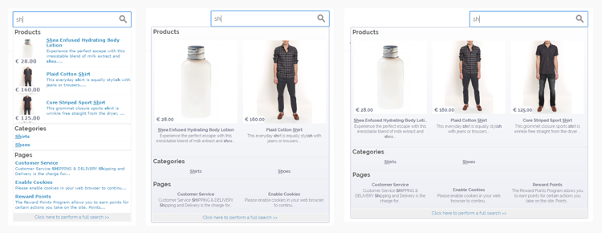

# Search Autocomplete Front-end Examples

Below are examples of the various Magento Search Autocomplete front-end display options.

## Search Results Dropdown Designs and Layouts

Search Autocomplete includes two search results dropdown designs, which both show the product name, description and a thumbnail image by default. Besides that the extension comes with three dropdown layouts: a single column list layout and a 2 and 3 column grid layout. See the image below for an example of each layout and theme.

The width percentage of the dropdown menu can be adjusted relative to the search field width. In the image below the width percentage of the list layout, 2 and 3 column grid layouts are set respectively to 100%, 150% and 200%.

The number of rows shown in the grid layouts can be expanded by increasing the maximum amount of displayed product suggestions.

In the examples below the search query highlighting option has been enabled, emphasizing and underlining the query 'dress' in the search results dropdown.

## Additional Search Autocomplete Options

Besides the product names, descriptions and images, you can also choose to show product prices, categories and/or CMS pages in the search results as exemplified below.

---

[Documentation index](./README.md) · [README](../README.md) · [Online version](https://plugin.company/knowledge-base/docs/magento-search-autocomplete/user-manual/search-autocomplete-frontend-examples/)
